<div align="center">

# loc4dgs

### Particle-filter 6-DoF camera localization in dynamic 4D Gaussian Splatting scenes

*Where is the camera, and which way is it pointing? This project answers that from a single image, in a scene full of moving people.*

[**Report (PDF)**](report/main.pdf) · [**Results**](#results) · [**How it works**](#how-it-works) · [**Reproduce**](#reproduce-everything)

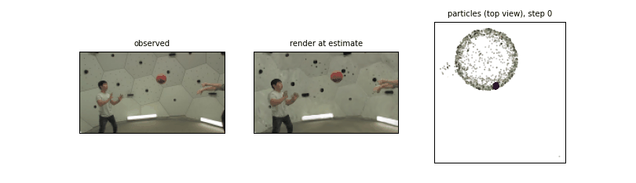

<sub>Relocalization on a real held-out photo (basketball). Left: the photo. Middle: the 4D map rendered from the filter's estimate. Right: the particle cloud (top view) contracting onto the true pose.</sub>

</div>

---

## In one paragraph

Robots, drones and AR headsets have to know their 6-DoF pose relative to a map, and most of the places where they are useful are full of people who move. **loc4dgs** treats camera localization as Bayesian state estimation on $SE(3)$ and solves it with a **particle filter whose measurement model is a renderer**. Each particle renders a pretrained **4D Gaussian Splatting** map ([Dynamic 3D Gaussians](https://dynamic3dgaussians.github.io/)) *at the image's own timestamp*, people included, and is weighted by how well that render matches the photo. Gaussian splatting renders in milliseconds, so the filter can afford **hundreds of renders per update**, about 9,000 renders per second on one GPU. The filter is compared with an **EKF and an iterated EKF** on the same map, with every method tuned on one scene and then frozen.

## Three claims, three results

| | Claim | Result (juggle · tennis · basketball) |
|---|---|---|
| **1** | The particle filter finds the pose **where the EKF can't**. | From a 30 cm / 20° start on **real photos**, the PF reaches 10 cm in **93% · 63% · 70%** of runs. The EKF and iterated EKF reach it in **0%** of 180 runs each. |
| **2** | The particle filter **tracks** a moving camera accurately and is **never overconfident**. | ATE **3.9 · 3.6 · 3.2 cm**, against 6.3 · 6.5 · 5.0 cm for the tuned EKF. The truth stays inside the PF's ±3σ band in **every frame**. |
| **3** | A **4D map at the correct time** beats a static or wrongly timed map. | A background-only, frozen or ±0.5 s map cuts the relocalization success from 18–57% to **0–15%** and raises the tracking ATE by **33–550%**. |

To the best of our knowledge, this is the first particle filter that localizes a camera in a time-synchronized **4D** Gaussian map, and the first study to measure how much that time synchronization matters.

---

## How it works

<p align="center">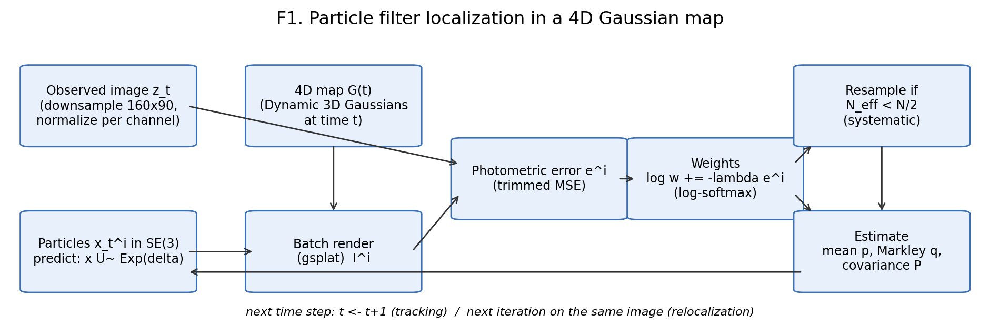</p>

Every time an image arrives, the filter runs one step:

1. **Observe:** downsample the image to 160×90 and normalize each colour channel. This makes the comparison insensitive to exposure.
2. **Predict:** move every particle by the odometry, then add right-multiplied noise $x^i \leftarrow x^i\,\tilde U_t\,\mathrm{Exp}(\delta^i)$.
3. **Pick the map for time $t$:** `scene.frame(t)`. This single line is where "4D" enters.
4. **Render:** render all particles in batches with [gsplat](https://github.com/nerfstudio-project/gsplat).
5. **Score:** compute a trimmed photometric error $e^i$, then update the weights in log space with a **tempered likelihood** $\log w^i \mathrel{-}= \lambda\, e^i$.
6. **Resample** (systematic) when $N_\text{eff} < N/2$.
7. **Estimate:** weighted mean position, Markley quaternion average, and the tangent-space covariance $\hat P$.

<details>
<summary><b>Why a tempered likelihood?</b></summary>

If the 43,200 pixel errors were independent, two particles whose errors differ by only 0.01 would have a weight ratio of about $10^{94}$, so one particle would take all the weight after a single update. Neighbouring pixels are strongly correlated, so the image carries the information of a few hundred independent measurements, not tens of thousands. The tempered likelihood $\log p(z\mid x) = -\lambda e$ encodes exactly that, with $\lambda$ tuned once: 50 for tracking, and $20 \rightarrow 200$ for relocalization, where $\lambda$ grows during the search.
</details>

<details>
<summary><b>Why does the EKF fail?</b></summary>

<p align="center">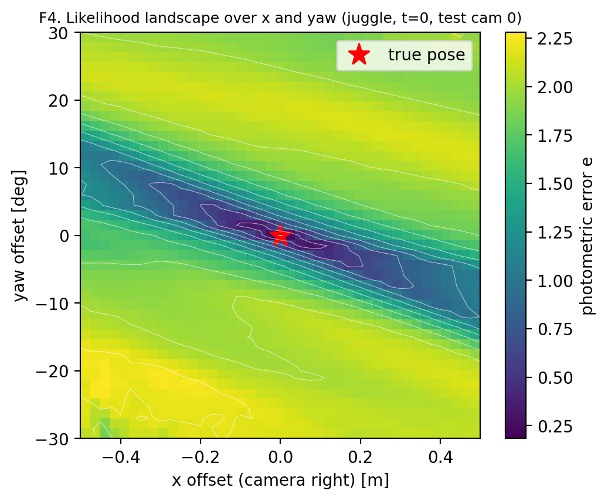</p>

The photometric error is low only in a **narrow diagonal valley** around the true pose, and almost flat everywhere else. An EKF linearizes the renderer, so it only feels the slope where it stands. From 30 cm / 20° away there is no slope to follow, and it stays where it started. A particle filter never differentiates the renderer. It tests many poses at once and keeps whichever explain the image.
</details>

<details>
<summary><b>Relocalization vs tracking</b></summary>

| Mode | Input | What changes |
|---|---|---|
| **Relocalization** | One **real** photo from a held-out test camera | No motion. The filter iterates on the same image with a random-walk search, annealing (600→200 particles, shrinking noise) and λ-tempering. |
| **Tracking** | 150 frames along a camera path between Panoptic cameras | Noisy odometry, and the time index advances each frame, so the map moves with the people. |
</details>

---

## Results

All numbers are medians over runs. Every method and every map sees the same images, starting poses, seeds and odometry. Settings were tuned on **juggle only** and then frozen, for the PF **and** the EKF baselines.

### Claim 1: relocalization from a poor initial guess (real photos)

<p align="center">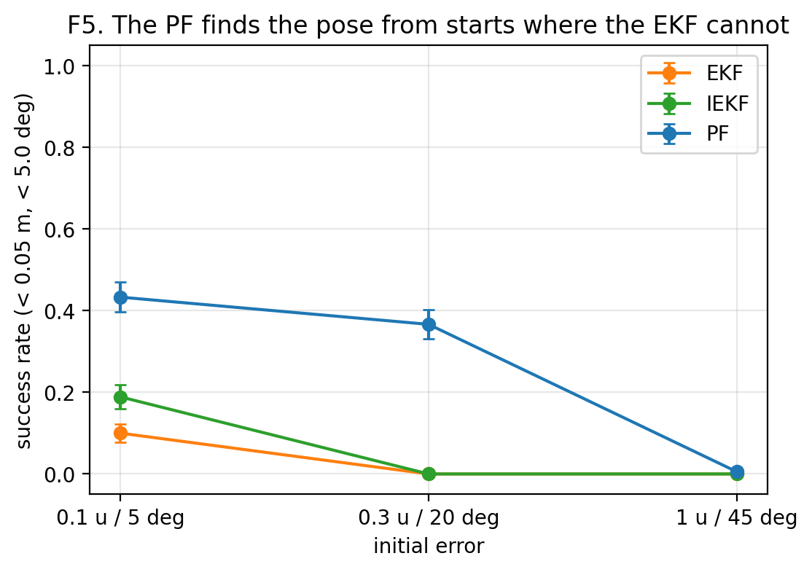</p>

| Start error | Method | juggle | tennis | basketball |
|---|---|:-:|:-:|:-:|
| 0.3 m / 20° | **PF** | **93%** · 5.5 cm | **63%** · 7.2 cm | **70%** · 4.3 cm |
| | EKF | 0% · 29.7 cm | 0% · 30.6 cm | 0% · 30.6 cm |
| | iterated EKF | 0% · 29.9 cm | 0% · 31.0 cm | 0% · 31.7 cm |

<sub>Success = final error below 10 cm and 5°; the second number is the median final error. 60 runs per cell (4 test cameras × 5 time steps × 3 seeds).</sub>

The EKF was given the same tuning effort as the PF: 12 settings of blur, measurement noise and finite-difference step, 1,728 runs. **No setting** recovers from 30 cm / 20°, so the failure is a property of linearization, not of the settings. The PF pays for its robustness with about 20× more compute: **4.1 s** per relocalization against 0.19 s for the EKF.

<p align="center">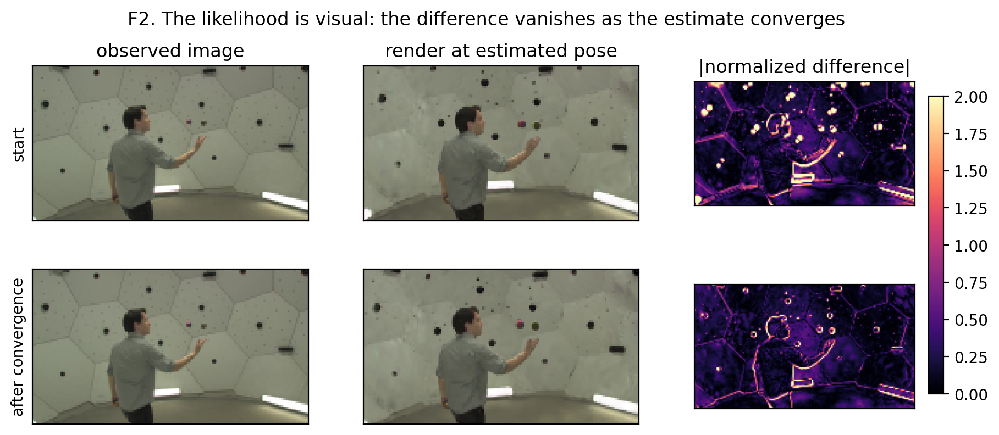</p>

**People are the best landmarks.** PF success rises steeply with how much of the view the people cover: **0%** below 3% coverage, **88%** above 10%. The static dome is made of almost identical wall panels, while people are unique, textured and high-contrast. The content that moves is the content that makes localization possible.

### Claim 2: tracking a moving camera

<p align="center">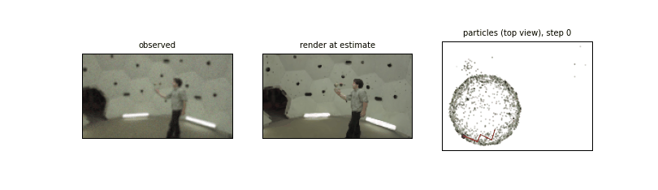</p>

| Scene | PF ATE | EKF ATE | PF NEES | EKF NEES | PF frames inside ±3σ |
|---|:-:|:-:|:-:|:-:|:-:|
| juggle | **3.9 cm** | 6.3 cm | 1.5 | 3.5 | **100%** |
| tennis | **3.6 cm** | 6.5 cm | 1.3 | 3.3 | **100%** |
| basketball | **3.2 cm** | 5.0 cm | 1.5 | 2.2 | **100%** |

<p align="center">
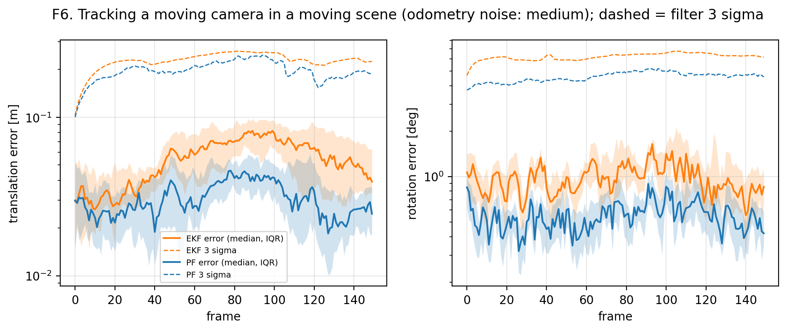
</p>

The PF is **36–45% more accurate** than the tuned EKF on every scene, runs at about **17 Hz** with 300 particles, and never loses the camera. Its uncertainty is **conservative**: NEES is below the χ² band and σ is about twice the actual error, so it is never overconfident. Before tuning, the EKF's NEES was 11–91, which is badly overconfident.

### Claim 3: the 4D map at the correct time matters

<p align="center">
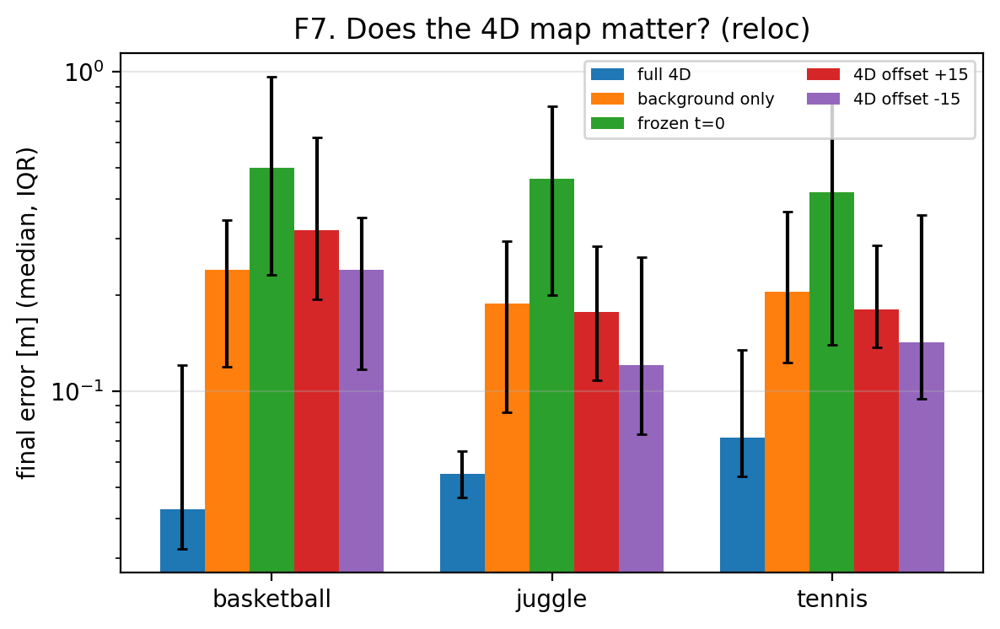
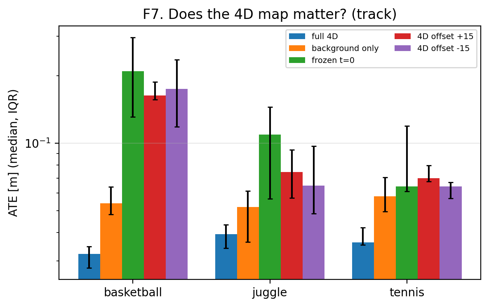
</p>

| Map (relocalization, real photos) | juggle | tennis | basketball |
|---|:-:|:-:|:-:|
| **full 4D, correct time** | **35%** | **18%** | **57%** |
| background only (people removed) | 7% | 3% | 3% |
| frozen at t = 0 | 7% | 5% | 13% |
| 15 frames late (+0.5 s) | 3% | 0% | 3% |
| 15 frames early (−0.5 s) | 12% | 7% | 15% |

<sub>Success = within 5 cm and 5°, 60 runs per cell. In paired runs (same photo and start), the full map wins 72–90% of the time; in tracking, 87–100%.</sub>

People cover only 6–11% of the image, yet the timing of the map changes everything. A mistimed person is a **displaced copy** that the filter tries to explain by moving the camera, so the map's error pulls the estimate in a consistent wrong direction. The effect grows with the share of the view the people cover:

<p align="center">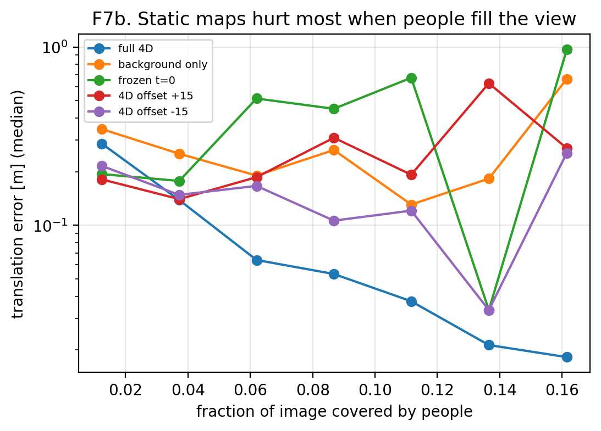</p>

### Supporting sweeps (juggle)

| | |
|:-:|:-:|
| 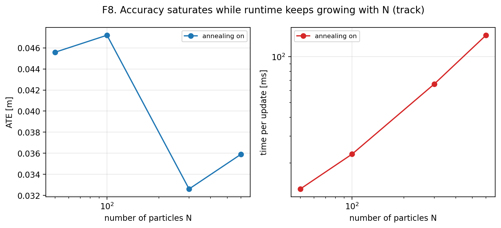 | 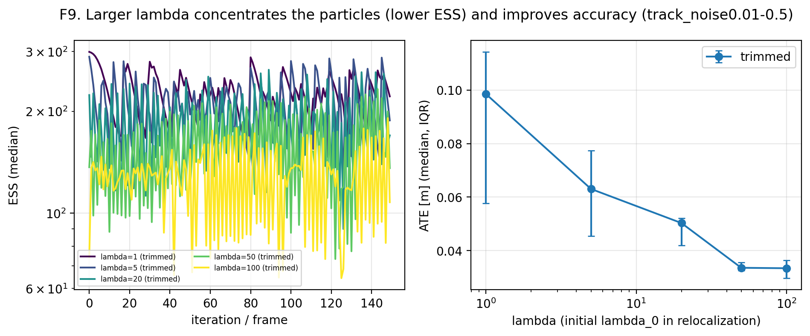 |
| **Particles:** accuracy saturates at about 300 while cost keeps growing. | **λ:** a sharper likelihood concentrates the particles and helps up to λ ≈ 50. |

### Honest limitations

- **Large errors:** from 1 m / 45°, every method fails, the PF included. 600 local particles are too sparse in 6-D. A global prior with particle injection is implemented but not evaluated.
- **~5 cm precision floor:** sideways shifts and small yaws produce almost the same image (the diagonal valley above), and the map itself isn't a perfect copy of reality.
- **Synthetic tracking images:** tracking observations are corrupted renders of the map. Relocalization uses real photos, and it confirms every conclusion.
- **Scope:** three of the six Panoptic scenes. The occlusion (E6) and kidnapping (E7) experiments are implemented but not run.

---

## Reproduce everything

### 1. Install

```bash
bash setup_env.sh              # conda env "loc4dgs": Python 3.10, torch 2.4.1+cu121, gsplat
conda activate loc4dgs
python -m pytest tests -q      # 16 tests on a small synthetic world, no dataset needed
```

### 2. Get the data and the pretrained 4D maps

```bash
bash download_data.sh          # Dynamic 3D Gaussians: CMU Panoptic data + pretrained params.npz
```

The code expects `../data/<scene>/` and `../output/pretrained/<scene>/params.npz`. Override the locations with `LOC4DGS_DATA`, `LOC4DGS_OUTPUT` and `LOC4DGS_EXP`.

### 3. Run the plan, stage by stage

```bash
python sanity_check.py --scene juggle   # render vs real photo (~30 dB), units, trajectory videos
bash run_plan.sh smoke                  # Stage 0: four smoke tests + run-time budget
bash run_plan.sh tune                   # Stage 1: tune λ and noise on juggle, then freeze config.py
bash run_plan.sh main                   # E1, E2, E3 on juggle, tennis, basketball (~2 h on one GPU)
bash run_plan.sh sweeps                 # E4: number of particles
bash run_plan.sh plots                  # every figure, table and GIF, from the CSVs only
```

Every run writes one CSV row per filter step to `results/`, and `plots.py` builds every figure and table from those files. No GPU? Add `--scene synthetic --backend torch` to any command to run on a small synthetic 4D world with a pure-PyTorch splatter.

---

## Repository layout

| File | What it does |
|---|---|
| [`se3.py`](se3.py) | Exp / Log / inverse / adjoint on $SE(3)$, quaternion helpers, Markley average |
| [`scene.py`](scene.py) | Loads the 4D map and builds $\mathcal G(t)$: `full`, `background`, `frozen0`, time offsets |
| [`render.py`](render.py) | Batched renderer $h(x)$ with gsplat, plus a pure-PyTorch EWA splatter as a fallback |
| [`observations.py`](observations.py) | Normalization, trimmed / Huber photometric error, blur, corruption, occluders |
| [`trajectories.py`](trajectories.py) | Camera paths between Panoptic cameras, odometry noise, local and global priors |
| [`pf.py`](pf.py) | SIR particle filter: predict, tempered update, systematic resampling, injection, estimate |
| [`ekf.py`](ekf.py) | Information-form EKF and iterated EKF with finite-difference Jacobians |
| [`metrics.py`](metrics.py) | Pose errors, ATE, NEES with χ² bands, coverage, success, convergence |
| [`run_reloc.py`](run_reloc.py) · [`run_track.py`](run_track.py) | The experiments (E1–E7) |
| [`plots.py`](plots.py) | Figures F1–F12, tables, GIFs, demo page |
| [`config.py`](config.py) | All parameters, **frozen after tuning on juggle** |
| [`sanity_check.py`](sanity_check.py) · [`smoke_test.py`](smoke_test.py) · [`tests/`](tests) | Go / no-go checks and unit tests |
| [`results/`](results) | CSVs, `figures/`, `tables/`, `gifs/` |
| [`report/main.pdf`](report/main.pdf) | Full report (PDF) |

<details>
<summary><b>Conventions and design decisions</b></summary>

- **Poses:** particles store camera-to-world poses; the renderer takes world-to-camera poses (OpenCV: x right, y down, z forward). Noise is right-multiplied, $T\,\mathrm{Exp}(\xi)$ with $\xi = (\rho, \phi)$.
- **Near plane 0.2 m:** this matches the original Dynamic 3D Gaussians rasterizer. With a smaller near plane, floaters near the cameras black out the renders.
- **Normalized error:** for per-channel-normalized images, the MSE equals $2(1-\rho)$, a bounded correlation distance. The worst 10% of pixels are trimmed, so occluders cannot dominate.
- **EKF:** information-form update on 80×45 blurred grayscale images, so only 6×6 matrices are inverted. The Jacobian comes from 12 extra renders, batched in one GPU call.
- **No ATE alignment:** the 4D map fixes the world frame, so estimates and ground truth are compared directly.
- **PF NEES is approximate:** the particle belief need not be Gaussian, so a distribution-free coverage test is also reported.
</details>

---

## Citation

```bibtex
@misc{dealwis2026loc4dgs,
  author = {Ransadi de Alwis},
  title  = {Particle Filter-Based 6-DoF Camera Localization in Dynamic 4D Gaussian Splatting Scenes},
  year   = {2026},
  note   = {EN4594 Autonomous Systems, University of Moratuwa},
  url    = {https://github.com/RansadiDeAlwis/loc4dgs}
}
```

## Acknowledgements

Built on [Dynamic 3D Gaussians](https://github.com/JonathonLuiten/Dynamic3DGaussians) (Luiten et al.; data and pretrained models), [gsplat](https://github.com/nerfstudio-project/gsplat) (rasterizer) and the [CMU Panoptic Studio](http://domedb.perception.cs.cmu.edu/) dataset. The filter design follows [Loc-NeRF](https://github.com/MIT-SPARK/Loc-NeRF) and *Probabilistic Robotics* (Thrun, Burgard, Fox).
